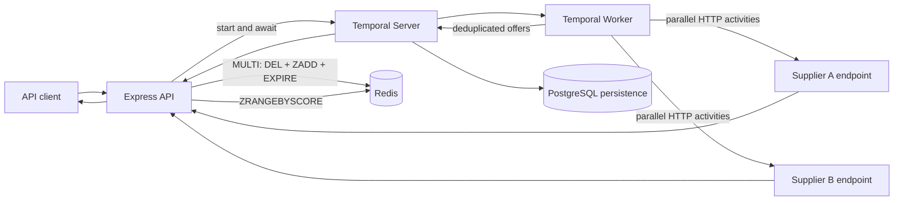

# Hotel Offer Orchestrator

A production-oriented take-home implementation that aggregates deterministic hotel offers from two supplier APIs. An Express API starts a Temporal workflow, the workflow fetches suppliers concurrently through activities, and the final cheapest offers are stored and price-filtered in Redis sorted sets.

## Architecture



PostgreSQL is Temporal infrastructure only; the application does not use it as an application database.

## Technology stack

- Node.js 22 and strict TypeScript
- Express 5
- Temporal TypeScript SDK
- Redis sorted sets via the official `redis` client
- PostgreSQL for Temporal persistence
- Docker Compose
- Vitest and Supertest

## Implemented requirements

- Health and two deterministic mock-supplier endpoints
- Case-insensitive city lookup across multiple cities
- Concurrent Temporal activities using `Promise.all`
- Activity timeouts and bounded exponential retries
- Hotel-name normalization with `trim().toLowerCase()`
- Cheapest-offer selection with deterministic equal-price tie-breaking
- Supplier and commission preservation
- Ascending price output
- Atomic per-city Redis sorted-set replacement and configurable TTL
- Inclusive minimum/maximum price filtering inside Redis
- Host-based and fully containerized development
- Unit, route, and real-Redis integration tests
- Importable Postman collection with assertions

## Orchestration and offer selection

`hotelOrchestrationWorkflow` accepts a city and schedules `fetchSupplierAHotels` and `fetchSupplierBHotels` concurrently. HTTP is performed only in activities, never inside workflow code.

Offers are keyed in a `Map` by normalized hotel name. A lower price wins. Equal prices are resolved by supplier name and then hotel ID, making workflow replay deterministic. The selected response retains `name`, `price`, `supplier`, and `commissionPct`.

## Redis design

Each request stores the final deduplicated workflow result—not raw supplier data—under:

```text
hotels:<normalized-city>
```

The sorted-set score is the hotel price and the member is the serialized complete response object. A transaction performs `DEL`, `ZADD`, and `EXPIRE`, replacing stale results atomically. Empty workflow results delete stale city data. The default TTL is 600 seconds.

Filtering uses Redis `ZRANGEBYSCORE` through `zRangeByScore`; offers are not fetched and filtered in JavaScript. Boundaries are inclusive.

## Docker setup

Prerequisites: Docker Desktop with Docker Compose.

```powershell
docker compose config
docker compose up -d --build
docker compose ps
```

Compose starts:

- API: `http://localhost:3000`
- Temporal frontend: `localhost:7233`
- Temporal UI: `http://localhost:8080`
- Redis: `localhost:6379`
- Worker, PostgreSQL, and the internal service network

The API and worker reuse the same application image. Container overrides use `temporal:7233`, `redis://redis:6379`, and `http://api:3000`. Named PostgreSQL and Redis volumes persist across normal container restarts. Do not use `docker compose down -v` unless data deletion is intended.

Check Redis:

```powershell
docker compose exec redis redis-cli ping
```

## Local host development

Prerequisites: Node.js 22+, npm, and the Compose infrastructure services.

```powershell
npm install
Copy-Item .env.example .env
docker compose up -d postgresql redis temporal temporal-ui
```

Run in separate terminals:

```powershell
npm run dev:api
npm run dev:worker
```

The checked-in `.env.example` contains host addresses. `.env` is ignored and is never copied into the Docker image.

## Environment variables

| Variable | Host default | Container value | Purpose |
|---|---|---|---|
| `PORT` | `3000` | `3000` | Express port |
| `TEMPORAL_ADDRESS` | `localhost:7233` | `temporal:7233` | Temporal frontend |
| `TEMPORAL_NAMESPACE` | `default` | `default` | Temporal namespace |
| `TEMPORAL_TASK_QUEUE` | `hotel-offers` | `hotel-offers` | Shared client/worker queue |
| `SUPPLIER_API_BASE_URL` | `http://localhost:3000` | `http://api:3000` | Activity HTTP base URL |
| `REDIS_URL` | `redis://localhost:6379` | `redis://redis:6379` | Redis connection |
| `REDIS_TTL_SECONDS` | `600` | `600` | Offer key TTL |

## API

| Endpoint | Description |
|---|---|
| `GET /health` | Liveness response |
| `GET /supplierA/hotels` | All Supplier A mock data |
| `GET /supplierB/hotels` | All Supplier B mock data |
| `GET /supplierA/hotels?city=delhi` | Supplier A mock data |
| `GET /supplierB/hotels?city=delhi` | Supplier B mock data |
| `GET /api/hotels?city=delhi` | Deduplicated offers |
| `GET /api/hotels?city=delhi&minPrice=5900` | Inclusive minimum |
| `GET /api/hotels?city=delhi&maxPrice=5900` | Inclusive maximum |
| `GET /api/hotels?city=delhi&minPrice=5340&maxPrice=5900` | Inclusive range |

Example response:

```json
[
  {
    "name": "HOLTIN",
    "price": 5340,
    "supplier": "Supplier B",
    "commissionPct": 20
  },
  {
    "name": "Radison",
    "price": 5900,
    "supplier": "Supplier A",
    "commissionPct": 13
  }
]
```

An unknown city returns `[]`.

The supplier endpoints accept an optional `city` filter. Omitting it returns the supplier's complete deterministic dataset. The orchestration endpoint always requires `city`.

## Testing

```powershell
npm run typecheck
npm run build
npm test
docker compose up -d redis
npm run test:integration:redis
```

The real-Redis suite uses `REDIS_URL` and must run while Redis is available. Import `postman/Hotel-Offer-Orchestrator.postman_collection.json` for the complete API collection and assertions.

## Temporal UI

`GET /health` returns HTTP 200 with `{"status":"ok","suppliers":{"supplierA":"healthy","supplierB":"healthy"}}` in normal operation. An unavailable mock changes its individual status to `unhealthy` and the overall status to `degraded`. Health uses the same in-process availability state as the supplier routes.

Workflow and activity logs use the Temporal SDK and include scheduling, supplier fetch outcomes, hotel counts, and failure classifications. Inspect them with `docker compose logs worker`.

### Optional Supplier B failure check

Run this separately from the healthy Newman collection:

```powershell
$env:MOCK_SUPPLIER_B_DOWN = 'true'
try {
  docker compose up -d --no-deps api
  curl.exe -i http://localhost:3000/health
  curl.exe -i http://localhost:3000/supplierB/hotels
  curl.exe -i "http://localhost:3000/api/hotels?city=delhi"
} finally {
  $env:MOCK_SUPPLIER_B_DOWN = 'false'
  docker compose up -d --no-deps api
  Remove-Item Env:MOCK_SUPPLIER_B_DOWN
}
```

Expect degraded health with HTTP 200, Supplier B with HTTP 503, and the aggregate request with HTTP 502 after three Supplier B attempts. Supplier A remains available. The default is `false`.

Open `http://localhost:8080`, select the `default` namespace, and inspect `hotelOrchestrationWorkflow` executions. Each API request uses a unique `hotel-offers-<UUID>` workflow ID.

## Project structure

```text
src/
  app.ts                         Express routes and validation
  config.ts                      Environment configuration
  data/supplier-hotels.ts        Deterministic supplier fixtures
  redis/client.ts                Redis lifecycle
  services/deduplicate-hotels.ts Pure offer selection
  services/hotel-offer-store.ts  Redis sorted-set storage/filtering
  temporal/activities.ts         Supplier HTTP activities
  temporal/client.ts             Workflow client
  temporal/worker.ts             Worker process
  temporal/workflows.ts          Deterministic workflow
tests/                            Unit, route, and integration tests
postman/                          Importable collection
dynamicconfig/                    Temporal development configuration
```

## Error handling

- Missing/empty city and invalid price parameters return HTTP 400.
- Supplier network/5xx failures are retried by Temporal within bounded policies.
- Temporal or Redis failures return a controlled HTTP 502 response.
- Internal exception details are logged server-side and are not exposed to callers.
- Redis connection attempts are bounded and never silently bypass filtering.
- API shutdown closes Redis and Temporal client connections; the worker closes its native Temporal connection after graceful SDK shutdown.

There is no supplier-failure fallback: successful aggregation requires both suppliers, as required by the assessment.

## Known limitations

- Supplier data is deterministic in-process mock data.
- Every hotel request executes a workflow before refreshing Redis; Redis is storage/filtering, not a read-through workflow cache.
- No authentication, rate limiting, observability backend, frontend, or application database is included.
- This repository is verified for local Docker Compose use; no public-cloud deployment is claimed.
